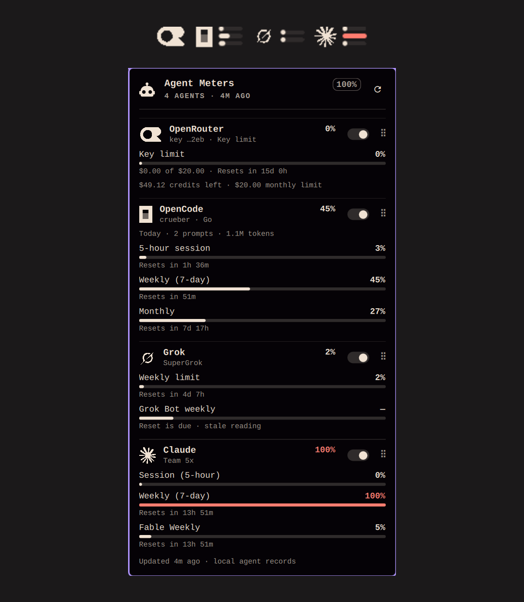

# Agent Meters

One Omarchy bar widget for every AI agent this machine actually uses.
**OpenRouter, OpenCode, Grok, Codex and Claude** each keep their own mark and
their own limit meters; an agent you have no plan, key or usage for simply
stays out of the bar. That is also the default bar order.



All images in this repository are composed from invented data: no real key,
account, workspace, spend, credits or usage figure is shown.

Agent Meters is the unified successor to three separate widgets — [OpenRouter
Usage](#predecessors), [OpenCode Go Usage](#predecessors) and [Grok
Usage](#predecessors) — with Codex and Claude added. The individual plugins
remain available if you prefer one agent per widget.

## Contents

- [What you get](#what-you-get)
- [Automatic selection](#automatic-selection)
- [Order, switches and dragging](#order-switches-and-dragging)
- [Each agent in detail](#each-agent-in-detail)
- [How it fetches](#how-it-fetches)
- [Colours and thresholds](#colours-and-thresholds)
- [Install](#install)
- [Use](#use)
- [Settings](#settings)
- [Privacy and security](#privacy-and-security)
- [Troubleshooting](#troubleshooting)
- [Remove](#remove)
- [Predecessors](#predecessors)
- [Development](#development)
- [Marketplace facts](#marketplace-facts)
- [Licence](#licence)

## What you get

| Agent | Bar | Panel rows |
| --- | --- | --- |
| **OpenRouter** | OpenRouter mark + meter, or dollars; with a management key, the credits left and this month's meter | This cycle's spend against the key's own limit, previous cycle, credits, reset; with a management key, every key on the account |
| **OpenCode** | OpenCode mark + up to three meters | 5-hour session, weekly, monthly, Console budgets, today's activity |
| **Grok** | Grok mark + weekly meter | Weekly or monthly plan limit, Grok Bot's separate weekly allowance, this week's local activity |
| **Codex** | Codex mark + session/weekly meters | Session, weekly, code review, model-scoped allowances, a Business seat's spend cap |
| **Claude** | Anthropic asterisk + up to three meters | Session (5-hour), weekly (7-day), Fable weekly |

Every agent gets:

- its mark drawn as a monochrome QML vector, so it follows the theme foreground
  and stays crisp at bar sizes;
- one meter per limit window, coloured by that window's own state;
- a panel section with percentages, meters, reset countdowns and clocks;
- an optional local-activity line (today, or this week for Grok);
- a row in the panel's settings with a show switch, and a drag handle in the
  agent list.

The agent marks are deliberately **not** tinted by state. When something is at
its limit, the meter, the percentage and the bar's active state turn urgent;
the mark stays in the theme foreground beside its neighbours.

## Automatic selection

The collector runs once per refresh and reports what each agent's own source
says. The bar only draws the agents that pass:

- **OpenRouter** — appears when a key is found: a [management
  key](#openrouter-management-key) for the whole account, else an inference
  key in `OPENROUTER_API_KEY`, the OpenCode `auth.json`, or OpenCode 2's
  credential store (`opencode auth export`). Keys are never cached by the
  widget.
- **OpenCode** — appears when the installed `opencode` answers with a Go
  allowance.
- **Grok** — appears when Grok's local billing snapshot has a weekly reading,
  or when only the Grok Bot desktop app has a reading.
- **Codex** — appears when Codex CLI is signed in to a plan with rate limits.
  An API-key sign-in has no plan limits and stays out of the bar.
- **Claude** — appears when Claude Code has a plan or limits. An expired
  sign-in still appears, labelled *Sign-in expired*, with the collector's hint
  to run `claude auth login`.

An agent with no plan, no key and no usage is left out rather than shown as an
empty shell. Detection is per machine: a plugin copied to another computer
shows that computer's agents.

## Order, switches and dragging

- **Default order:** OpenRouter, OpenCode, Grok, Codex, Claude. A saved
  `providerOrder` wins; agents missing from it are appended in the default
  order, so a newly supported agent appears without a settings edit.
- **Drag to reorder:** grab an agent row by the `⠿` grip and drop it where you
  want it. A ghost follows the pointer, an accent line shows the insertion
  point, and the bar icons follow immediately. Dropping on the last row's lower
  half moves the agent to the end.
- **Show switches:** in the panel's settings (the gear), every agent has a
  switch, on by default. Turning one off keeps its row — and its limits — in
  the agent list so you can read it or switch it back on, but removes its mark
  and meters from the bar. The hero reports how many agents are hidden, and an
  all-hidden bar says so in its tooltip.
- Both controls write the same widget settings the settings page exposes
  (`providerOrder`, `show<Agent>`), so the panel and `shell.json` never drift.

## Each agent in detail

### OpenRouter

OpenRouter has no subscription. The widget asks OpenRouter for the key's own
budget with `GET https://openrouter.ai/api/v1/key`; the key is used only in an
HTTPS `Authorization` header. Account credits come from
`GET /api/v1/credits` when OpenRouter reports them.

- **Limited key:** a meter of current cycle spend against the key's limit.
- **No key limit:** the spend in dollars. Once one completed cycle has been
  observed, the previous cycle's spend becomes the effective limit and a meter
  appears. Going over it switches back to dollars and turns yellow.
- **Zero spend:** only the mark is drawn; the popup still opens with the
  zero-spend cycle, limit and reset details.
- **Previous cycle:** exactly one current and one previous cycle are kept. A
  previous cycle is used only when it was observed close to its reset, so a
  partial or missed cycle cannot become a misleading baseline.
- **Reset:** the key's own reset interval and date, monthly by default.

#### OpenRouter management key

An inference key only sees itself. A **management key** sees the whole
account: create one at
[openrouter.ai/settings/management-keys](https://openrouter.ai/settings/management-keys)
and set it from the panel or store it with the helper. Management keys cannot
run completions, but they **can create and delete your API keys**, so the
widget treats one as a credential, not a setting.

From the panel: open Agent Meters, click the gear, and set the key there (the
OpenRouter block in the panel's settings view). The field is masked (the eye
button reveals it), Enter or the check button stores it, Esc cancels. The
status then says *Management key: set (Secret Service)* or *set (file)*, and a
trash button removes it. The key never goes into the widget's settings; it is
handed to the helper below on stdin and the field is cleared.

The same thing from a terminal:

```bash
~/.config/omarchy/plugins/crueber.agent-meters/scripts/set-management-key.sh           # paste at the hidden prompt
wl-paste | ~/.config/omarchy/plugins/crueber.agent-meters/scripts/set-management-key.sh  # or pipe it in
~/.config/omarchy/plugins/crueber.agent-meters/scripts/set-management-key.sh --status   # where is it stored?
~/.config/omarchy/plugins/crueber.agent-meters/scripts/set-management-key.sh --remove   # back to the per-key view
```

The helper never takes the key as an argument (argv is readable by every
process through `/proc`), never prints it, and hands it to `secret-tool` on
stdin. The collector looks for a key in this order:

1. `OPENROUTER_MANAGEMENT_KEY` in the environment the shell runs the collector
   with (your login shell);
2. the freedesktop **Secret Service** — gnome-keyring on Omarchy — as the item
   `service=agent-meters account=openrouter-management`
   (`secret-tool lookup service agent-meters account openrouter-management`),
   which is where the helper stores it;
3. the file `${XDG_DATA_HOME:-~/.local/share}/agent-meters/openrouter-management-key`,
   written by `set-management-key.sh --file` (or when no Secret Service
   answers). The directory must be `0700` and the file `0600`, both owned by
   you and neither a symlink; anything else is refused with an error that
   says why. It deliberately lives outside `~/.config`, which many people sync
   as dotfiles.

Note that Omarchy's default keyring is set up **without a password**, so the
Secret Service does not encrypt the key at rest any more than the `0600` file
does (the keyring itself is a file under `~/.local/share/keyrings`); full-disk
encryption covers both. If you protect your keyring with a password, the
Secret Service copy is encrypted while the keyring is locked.

**When a management key is found it takes over** — the inference key is not
used at all. The collector reads `GET /api/v1/keys` (enabled, unexpired keys,
100 per page, at most 10 pages) and `GET /api/v1/credits`, and shows:

- **Bar:** the OpenRouter mark, the credits left (`$20.81`) and one meter —
  this month's spend against the average monthly spend of the previous N full
  calendar months (UTC). Without a baseline there is no meter, only the
  dollars; if OpenRouter does not report credits for the account, the dollars
  are this month's spend. Text style: `$20.81 · 82%`.
- **All keys · this month** — the sum of every key's `usage_monthly`, as a
  meter captioned like *$49.93 of $61.20 avg (Sep–Oct) · Resets in 11d 7h*
  (*(Oct)* for one month, *avg (2 of 3 months)* when fewer months are known).
  Over the average it turns yellow, shows the real percent (say 120%) and says
  *over the 2-month average* (or *over last month*).
- **Credits** — *$20.81 left*: a plain figure, no meter, and no lifetime
  purchase or usage totals.
- **The top N keys by spend this month** (`openrouterKeyRows`, default 3).
  Keys with no spend this month are left out. A key with a spending limit is a
  meter against it with its reset (daily at 00:00 UTC, weekly on Monday 00:00
  UTC, monthly on the 1st); a key without one is *$X.XX this month*. Rows use
  the key's name, else *Key …* and four characters — never OpenRouter's full
  key label.
- **The average** comes from OpenRouter's analytics (`GET
  /api/v1/analytics/meta` to find the cost metric, then one `POST
  /api/v1/analytics/query` for the N months). The answer is parsed strictly;
  anything unexpected means "no analytics", silently. A good answer is cached
  with the widget's numbers and asked again only next month or when N
  changes; an unavailable one is retried at most once a day. Without
  analytics, the widget averages the months it has observed itself (it keeps
  up to twelve completed months). `openrouterAverageMonths` 0 turns the meter
  off and makes no analytics request at all.
- **Errors:** an expired or revoked key (*Management key expired or
  invalid*, with the link to create a new one), a key that is not allowed
  (HTTP 403), an account whose key cannot list keys (HTTP 404, *personal
  accounts may need an organization*), or no network. The widget keeps the
  last good numbers with the error and **does not fall back to the inference
  key**; fix or remove the management key.

The panel's settings view shows *Management key: set (Secret
Service | file | env)* or *not set*. The key button sets or changes it (a
masked field; Esc cancels) and the trash button removes it; the key is never
shown again and is not a setting. When the key comes from
`OPENROUTER_MANAGEMENT_KEY`, the panel says so and leaves it to the
environment.

### OpenCode

The numbers come from the local OpenCode service — no second login, no key to
paste:

```bash
opencode api GET /api/experimental/usage/limits
```

That endpoint reports the Go allowance and Console budgets of the workspace
your installed OpenCode is signed in to. If the background service is not
running, the collector retries once with `--standalone`, which starts a private
server for that request and reads the same credentials.

The widget shows the 5-hour session, weekly and monthly windows, any Console
budgets, and today's prompts/tokens from the local OpenCode record. The
endpoint is experimental, so a future OpenCode release may change its shape.

### Grok

There is no API key, no network request and no second login. The installed Grok
CLI asks its background service for billing data when a session starts and
writes the answer to:

```text
~/.grok/logs/unified.jsonl
```

The widget reads that snapshot and sums the numeric per-turn ledgers under
`~/.grok/sessions/<workspace>/<session>/usage.json` for local activity.

**Grok Bot** has a separate weekly allowance. Its desktop app caches the reading
under `~/.config/Grok Bot/sand-client-persistence/*.blob`; the widget reads the
newest small JSON blob for `percentUsed` and `nextResetMs`. Open Grok Bot to
refresh that cache. The blob is read locally; no token or session cookie is
touched. A Bot reading past its expiry is shown as stale with an em dash.

Grok Bot on its own is enough: without the Grok CLI, Grok still appears with
both meters — the plan's **Weekly limit** (empty, since only the CLI reports it)
and **Grok Bot weekly** — with the plan label taken from the Bot's reading.

Grok only updates its snapshot when a Grok session runs — also the only time
your allowance can change — so run `grok` once (and open `/usage` if this is the
first time) to create the first snapshot. The panel footer says how old the
reading is.

### Codex

Codex limits come from the Codex app-server RPC (`account/rateLimits/read`)
through Omarchy's Codex collector, which owns the OAuth refresh and its own
cache. The widget reads the display-ready result:

- the general **session** and **weekly** windows;
- **code-review** windows when the account has them;
- a **model's own allowance**, titled with its model (`o3 Weekly`), kept as a
  separate row;
- a Business seat's **spend cap** when that is what the app-server reports.

An API-key sign-in has no plan limits and stays out of the bar. Run
`codex login` to use a subscription plan.

### Claude

Claude uses `omarchy-agent-usage-claude`, the same collector as Omarchy's
built-in Agents panel, so the widget inherits Anthropic's OAuth probe, its
short-lived cache and its account selection:

- **Session (5-hour)**
- **Weekly (7-day)**
- **Fable weekly** — the model-scoped allowance that only Fable spends
  against, shown as its own bar and row.

An expired sign-in keeps the agent in the bar with *Sign-in expired* and the
collector's `claude auth login` hint. A machine with several Claude accounts
uses the active account's numbers.

## How it fetches

One collector process feeds the whole widget. Each provider keeps its own
source, and the collector normalizes them into the same shape:

| Agent | Source |
| --- | --- |
| OpenRouter | Management key (`OPENROUTER_MANAGEMENT_KEY`, `secret-tool`, or the `0600` key file): `/api/v1/keys`, `/api/v1/credits`, `/api/v1/analytics/meta`, `POST /api/v1/analytics/query`. Otherwise `OPENROUTER_API_KEY`, OpenCode `auth.json`, or `opencode auth export`; then `/api/v1/key` and `/api/v1/credits` |
| OpenCode | `opencode api GET /api/experimental/usage/limits` (retries `--standalone`) |
| Grok | `scripts/grok.js` over `~/.grok`, plus the Grok Bot app cache; falls back to Omarchy's `grok.json` record |
| Codex | `omarchy-agent-usage-codex --limits-only`, falling back to `~/.local/state/omarchy/agents/usage/codex.json` |
| Claude | `omarchy-agent-usage-claude --limits-only`, falling back to `~/.local/state/omarchy/agents/usage/claude.json` |

Schedule and caching:

- Automatic refresh: `refreshIntervalSec`, default **5 minutes** (60–3600).
- Manual refresh (middle click, `r`, IPC): at most once every **30 seconds**.
- Failed reads back off from **1 minute up to 10 minutes**.
- The last good result is cached at `~/.cache/agent-meters/usage.json` and
  painted immediately on shell restart; the cache waits out the rest of the
  refresh interval instead of re-reading.
- One bar surface exists per monitor, but only an elected leader fetches; the
  others consume the published result.
- A failed provider keeps its last good numbers and gains an error. One
  endpoint being down never blanks the other agents.

Claude and Codex collectors are invoked from the login-shell PATH. Set
`nodeCommand`, `opencodeCommand`, `codexCommand` or `claudeCommand` if your
shell needs an absolute path.

## Colours and thresholds

Each meter follows its own window:

1. **Red / urgent** — at or above `criticalPercent` (default 90), or a window
   the source marks as limited.
2. **Orange** — at or above `warnPercent` (default 70).
3. **Yellow** — OpenRouter only: the current cycle is over the previous
   completed cycle (with a management key: this month is over the N-month
   average).
4. **Foreground** — everything else.

`warningColor` and `criticalColor` override the theme; empty values keep the
theme foreground and urgent colour. Agent marks are always the theme
foreground.

## Install

Install it the standard Omarchy way:

```bash
omarchy plugin add https://github.com/crueber/omarchy-plugin-agent-meters --enable
```

The command validates the manifest before installing and enables the widget in
the right bar section.

From a local checkout, the installer does the same deployment:

```bash
cd /path/to/omarchy-plugin-agent-meters
./scripts/install.sh
```

The installer copies the runtime files to
`~/.config/omarchy/plugins/crueber.agent-meters/`, validates the plugin, rescans
the shell, and enables it. Pass a section as the first argument (`left`,
`centerBegin`, `center`, `centerEnd`, `right`) or place it afterwards:

```bash
omarchy plugin enable crueber.agent-meters --section right --after nino.tailscale
omarchy bar move crueber.agent-meters --section right --index 0
```

Saved changes to the plugin hot-reload. If the bar keeps showing an older
build — most often after changing `Model.js` or a mark — restart the shell once
with `omarchy restart shell`.

### Requirements

- Omarchy Quattro with the Omarchy shell bar and its Agents panel present.
- Node.js for the collector (`node` on the login-shell PATH, or set
  `nodeCommand`).
- At least one of:
  - an OpenRouter key (`OPENROUTER_API_KEY`, or signed in to OpenRouter through
    OpenCode), or an OpenRouter management key stored with
    `scripts/set-management-key.sh` (uses `secret-tool` from `libsecret`,
    which Omarchy installs, when available);
  - OpenCode v2.x signed in to a workspace with a Go plan
    (`opencode auth list`);
  - Grok CLI with an existing login and at least one session;
  - Codex CLI signed in to a subscription plan (`codex login`);
  - Claude Code signed in (`omarchy agent account list claude`).

No elevated privileges, no extra services and no daemon of its own.

## Use

- **Left click** — open or close the panel.
- **Middle click** — refresh every agent now.
- **Right click** — open this plugin's page, or run `onRightClick` if set.
- **Gear** — open the panel's settings (agent switches, OpenRouter management
  key, account-view numbers); the back arrow returns to the agents.
- **`r`** — refresh while the panel is open.
- **Escape** — close the panel (in settings, go back first).
- **Drag the `⠿` grip** — reorder agents.
- **Settings switches** — show or hide an agent in the bar.

IPC, useful for scripts and diagnostics:

```bash
omarchy-shell agent-meters text       # one line per visible agent
omarchy-shell agent-meters providers  # visible providers as JSON
omarchy-shell agent-meters refresh
omarchy-shell agent-meters toggle
omarchy-shell agent-meters move grok -1
omarchy-shell agent-meters setupKey   # open settings with the key field focused
```

## Settings

Settings live inline on the widget's `shell.json` entry and are described in
`manifest.json`. Change them from the widget settings UI or with:

```bash
omarchy bar set crueber.agent-meters refreshIntervalSec 600
omarchy bar set crueber.agent-meters barStyle text
omarchy bar set crueber.agent-meters showCodex false --json
```

The panel's settings view (the gear in the panel) covers the per-agent
switches, the OpenRouter management key, and the two OpenRouter account-view
settings, `openrouterKeyRows` and `openrouterAverageMonths`, as steppers. It
writes the same `show<Agent>` and OpenRouter keys to `shell.json`, so the
panel and the widget settings UI never drift.

| Key | Default | Meaning |
| --- | --- | --- |
| `barStyle` | `bars` | `bars`, `text` (short percentages per agent) or `icon` |
| `showOpenrouter` | `true` | Show OpenRouter in the bar |
| `showOpencode` | `true` | Show OpenCode in the bar |
| `showGrok` | `true` | Show Grok in the bar |
| `showCodex` | `true` | Show Codex in the bar |
| `showClaude` | `true` | Show Claude in the bar |
| `providerOrder` | `""` | Drag-and-drop order, comma-separated ids; empty uses OpenRouter, OpenCode, Grok, Codex, Claude |
| `refreshIntervalSec` | `300` | Refresh interval (60–3600) |
| `warnPercent` | `70` | Warning threshold |
| `criticalPercent` | `90` | Critical threshold |
| `warningColor` | `#f67400` | Empty keeps the theme foreground |
| `criticalColor` | `""` | Empty uses the theme urgent colour |
| `nodeCommand` | `""` | Optional path to `node` |
| `authFile` | `""` | Optional OpenCode 1 auth file for the OpenRouter key |
| `grokHome` | `""` | Optional Grok home; default `$GROK_HOME` or `~/.grok` |
| `botHome` | `""` | Optional Grok Bot cache directory |
| `opencodeCommand` | `""` | Optional path to `opencode` |
| `codexCommand` | `""` | Optional path to `omarchy-agent-usage-codex` |
| `claudeCommand` | `""` | Optional path to `omarchy-agent-usage-claude` |
| `showActivity` | `true` | Show the local-activity line per agent |
| `openrouterKeyRows` | `3` | Management key only: how many of the keys with the most spend this month the panel lists (0–12) |
| `openrouterAverageMonths` | `2` | Management key only: months the usage meter averages (0–12; 0 = dollars only, no analytics request) |
| `onRightClick` | `""` | Optional shell command for right click |

The per-agent switches in the panel's settings view are the same
`show<Agent>` keys, written with `--json` so `shell.json` stores real
booleans.

The OpenRouter management key is **not** a setting and never goes into
`shell.json`; set it from the panel's settings view or with
`scripts/set-management-key.sh` (see [OpenRouter management
key](#openrouter-management-key)). The account-view steppers write
`openrouterKeyRows` and `openrouterAverageMonths`; changing the first redraws
immediately, and changing the second redraws from the observed months at once
and asks analytics for the new window on the next allowed refresh.

## Privacy and security

- **Keys are never cached, logged, printed or passed on a command line.** The
  OpenRouter key is used only in an HTTPS `Authorization` header at request
  time. It is read from `OPENROUTER_API_KEY`, OpenCode's credential file, or
  `opencode auth export`.
- **The OpenRouter management key** (which can create and delete API keys) is
  read only from `OPENROUTER_MANAGEMENT_KEY`, the Secret Service, or a `0600`
  file in a `0700` directory (symlinks and loose modes refused). The collector
  removes it from its own environment before starting any other program, sends
  it only to `openrouter.ai` in the `Authorization` header, and scrubs it from
  any error text. It is never in `shell.json`, the widget settings, the cache,
  the IPC output, the collector's JSON or the logs. The only place to type one
  is the panel's masked key field, which hands it to
  `scripts/set-management-key.sh` on stdin and clears it immediately.
- **Local reads:** `~/.grok`, the Grok Bot app cache, OpenCode's local API,
  OpenCode's credential export, and Omarchy's usage records. The Grok helper
  never opens `~/.grok/auth.json`.
- **Network reads by this plugin:** OpenRouter's `/api/v1/key` and
  `/api/v1/credits`, and with a management key `/api/v1/keys`,
  `/api/v1/analytics/meta` and `POST /api/v1/analytics/query` (at most once a
  month for a good answer). Claude's OAuth probe and Codex's app-server RPC are
  performed by Omarchy's own collectors, under their caching and rate-limit
  handling.
- **Cache:** `~/.cache/agent-meters/usage.json` in a mode-`0700` directory. It
  holds displayed numbers, reset times, the masked OpenRouter key label, and
  the OpenRouter cycle history and analytics average. With a management key it
  also holds the per-key rows (key names, spend, limits). No prompts,
  responses, session text, tokens, keys or account identity. Delete it at any
  time.
- **Untrusted text:** every string from a file or network is neutralised before
  display, percentages are clamped to 0–100, and response sizes are bounded.
- The plugin writes nothing outside
  `~/.config/omarchy/plugins/crueber.agent-meters/` and
  `~/.cache/agent-meters/`; bar layout and settings live in `shell.json`,
  managed by Omarchy. Only the helper you run yourself writes the management
  key (to the Secret Service or `~/.local/share/agent-meters/`).

See `SECURITY.md` for reporting and the full data-flow notes.

## Troubleshooting

**No agents in the bar.** Run `omarchy-shell agent-meters text`. If it prints
`no agents`, none of the five sources is configured on this machine. The
panel's empty state names the sign-in paths. If it lists agents but the bar is
empty, check the show switches — the hero reports hidden agents.

**An agent should appear but does not.**

| Agent | Check |
| --- | --- |
| OpenRouter | `opencode auth export` contains an `openrouter` credential, or `OPENROUTER_API_KEY` is set; then `omarchy-shell agent-meters refresh` |
| OpenCode | `opencode auth list`; `opencode api GET /api/experimental/usage/limits` answers |
| Grok | `~/.grok/logs/unified.jsonl` exists; run `grok` once and open `/usage` |
| Codex | `codex login`; an API-key sign-in intentionally has no plan limits |
| Claude | `omarchy agent account list claude`; run `claude auth login` if expired |

**Claude says "Sign-in expired".** Run `claude auth login` (or start Claude
Code) and refresh. The agent stays visible so the meters return as soon as the
sign-in is fixed.

**Grok Bot shows an em dash or "stale reading".** Its cached reading has
expired. Open the Grok Bot desktop app to refresh it.

**OpenCode did not answer.** The endpoint is experimental. Confirm the CLI
works with `opencode api GET /api/experimental/usage/limits`; the collector
also retries once with `--standalone`.

**OpenRouter says "Management key expired or invalid".** Create a new key at
[openrouter.ai/settings/management-keys](https://openrouter.ai/settings/management-keys)
and set it again from the panel's OpenRouter section (or with
`scripts/set-management-key.sh`), or remove it with the trash button (or
`--remove`) to go back to the per-key view. The widget does not switch to the
inference key on its own.

**"…can't list keys (personal accounts may need an organization)".**
OpenRouter answered HTTP 404 for `/api/v1/keys`; remove the management key
with `set-management-key.sh --remove` to use the per-key view.

**"…must be mode 0600" / "…is a symlink" / "…must be mode 0700".** The key
file is refused until it is a regular file you own with
`chmod 600 ~/.local/share/agent-meters/openrouter-management-key` inside
`chmod 700 ~/.local/share/agent-meters`. Rerunning
`set-management-key.sh --file` rewrites both correctly.

**"The Secret Service did not answer".** `secret-tool lookup` took more than
3 seconds, usually because the keyring is locked. Unlock it (Omarchy's default
keyring has no password, so this should not happen there), or store the key
with `set-management-key.sh --file`.

**No usage meter with a management key.** There is no baseline yet: analytics
was unavailable and the widget has not observed a full month. The meter
appears after the first completed month, or set `openrouterAverageMonths` to
`0` to keep dollars only on purpose.

**OpenRouter says "no OpenRouter key found".** Set `OPENROUTER_API_KEY`, sign
in to OpenRouter in OpenCode (`opencode auth login`), or point `authFile` at an
OpenCode 1 credential file. OpenCode 2 users need no extra step: the collector
reads `opencode auth export`.

**"node not found; set the Node executable".** Set `nodeCommand` to the absolute
path of `node`.

**Numbers look old.** Open the panel or run
`omarchy-shell agent-meters refresh`; check `showActivity` and the footer's
"Updated …". Failed checks back off up to 10 minutes.

**The bar still shows an older build after an update.** Restart the shell once:
`omarchy restart shell`.

## Remove

```bash
omarchy plugin disable crueber.agent-meters
~/.config/omarchy/plugins/crueber.agent-meters/scripts/set-management-key.sh --remove  # before removing, if you stored one
omarchy plugin remove crueber.agent-meters --yes
rm -rf ~/.cache/agent-meters
```

The `rm` is optional — it only discards the cached numbers so they do not linger
on disk. A clone of the repository can be deleted as well. The plugin writes
nothing else.

## Predecessors

Agent Meters is the unified version of three plugins that remain available on
their own:

| Predecessor | What it contributes |
| --- | --- |
| [OpenRouter Usage](https://github.com/crueber/omarchy-plugin-openrouter-usage) | Key-limit and dollar modes, previous-cycle comparison, account credits, OpenCode credential handling |
| [OpenCode Go Usage](https://github.com/crueber/omarchy-plugin-opencode-usage) | Session/weekly/monthly Go meters, Console budgets, local activity, standalone retry |
| [Grok Usage](https://github.com/crueber/omarchy-plugin-grok-usage) | Weekly plan meter, Grok Bot's separate allowance, local session ledgers, snapshot age |

The unified widget adds Codex and Claude, one panel instead of three popups,
automatic detection, per-agent switches and drag-to-reorder. In exchange it
shows one compact activity line per agent instead of the individual plugins'
longer 30-day and billing sections — install a predecessor if you want that
deeper local detail for a single agent.

## Development

The repository is the source of truth; the live plugin is
`~/.config/omarchy/plugins/crueber.agent-meters/` and should be updated with
`./scripts/install.sh` rather than edited in place. `AGENTS.md` documents the
architecture and invariants for anyone — human or agent — changing the plugin.

```bash
./scripts/validate.sh     # manifest, required files, offline tests, plugin validate
node scripts/test-model.js
node scripts/test-collect.js
./scripts/install.sh
```

The tests are offline: `test-model.js` covers parsing, window/state math,
OpenRouter cycle history, ordering, switches and cache round-trips;
`test-collect.js` drives the collector with fake `opencode`, `claude`,
`codex` and `secret-tool` binaries, a temporary HOME, and OpenRouter answered by
`scripts/test-https-stub.js` (preloaded with `node -r`), so CI needs no real
account and no network.

Layout:

```text
manifest.json          plugin id, bar-widget entry point, settings schema
Panel.qml              bar chips, unified panel, fetch/cache lifecycle
ProviderMark.qml       resolves and themes marks/<Provider>Mark.qml
Model.js               pure parsing, windows, state, cache, poll coordination
marks/                 monochrome vector marks (OpenRouter, OpenCode, Grok, Codex, Claude)
scripts/collect.js     one collector, five provider sources
scripts/grok.js        Grok log/session/Bot reader
scripts/set-management-key.sh  store/remove the OpenRouter management key (stdin only)
scripts/test-https-stub.js     offline OpenRouter answers for the collector tests
scripts/install.sh     deploy to the live plugin directory
scripts/validate.sh    manifest + files + tests + omarchy plugin validate
```

## Marketplace capability notes

This repository ships one installer and no screenshot or demo-capture script.

- **Installer (`installer` capability).** `scripts/install.sh` copies the
  reviewed runtime files into
  `~/.config/omarchy/plugins/crueber.agent-meters/`, validates the manifest,
  rescans the shell and enables the widget. It uses no sudo, no network and no
  build step, and writes nowhere else.
- **No remote build.** The documented install is `omarchy plugin add`; the
  plugin does not fetch or execute code from the network.
- **Local executables.** Runtime reads use only `node`, `opencode`,
  `omarchy-agent-usage-claude` and `omarchy-agent-usage-codex` (each
  configurable), and `secret-tool lookup service agent-meters account
  openrouter-management` (from `libsecret`, 3-second timeout; skipped when not
  installed), plus the local files described above. The optional
  `scripts/set-management-key.sh` helper, run only by the user, calls
  `secret-tool store|clear` and writes nothing but
  `~/.local/share/agent-meters/openrouter-management-key`.
- **Network.** Only `https://openrouter.ai`: `/api/v1/key` and
  `/api/v1/credits`, and with a management key `/api/v1/keys`,
  `/api/v1/analytics/meta` and `POST /api/v1/analytics/query`, always with the
  key in an HTTPS header. Claude's and Codex's probes belong to Omarchy's
  collectors.
- **Previews.** `preview.png` and `screenshots/bar.png` are composed offline
  from a synthetic fixture. No real key, account, workspace, spend, credits or
  usage appears. There is no demo or capture script to run, and therefore no
  temporary copies of live caches or settings.

## Marketplace facts

- **Plugin id:** `crueber.agent-meters`
- **Name:** Agent Meters
- **Version:** 1.2.0
- **Kind:** `bar-widget` (`Panel.qml`)
- **Category:** AI
- **Aliases:** `agent-meters`, `agents`, `ai-agents`, `openrouter`, `opencode`,
  `grok`, `codex`, `claude`
- **Default section:** `right`
- **IPC target:** `agent-meters`
- **Licence:** MIT
- **Source:** https://github.com/crueber/omarchy-plugin-agent-meters
- **Preview:** `preview.png` (bar and panel) and `screenshots/bar.png`
- **Validation:** `./scripts/validate.sh` and `omarchy plugin validate`
- **Install / remove:** standard `omarchy plugin add` / `omarchy plugin remove`

## Licence

MIT. Claude and Anthropic are trademarks of Anthropic; Codex and OpenAI are
trademarks of OpenAI; Grok and xAI are trademarks of their respective owner;
OpenCode and OpenRouter are trademarks of their respective owners. The marks
in this repository are traced monochrome geometry used only to identify the
service each meter belongs to.
